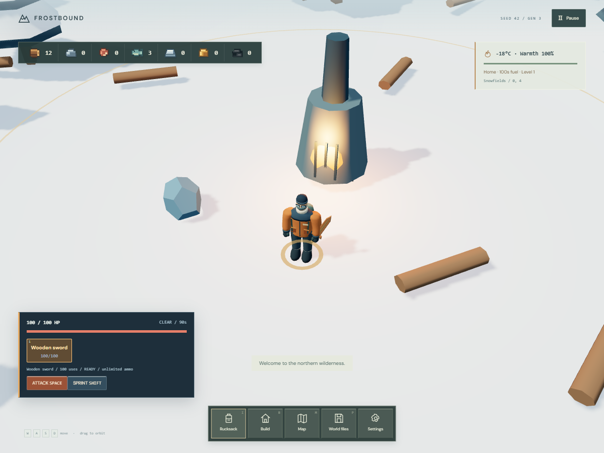
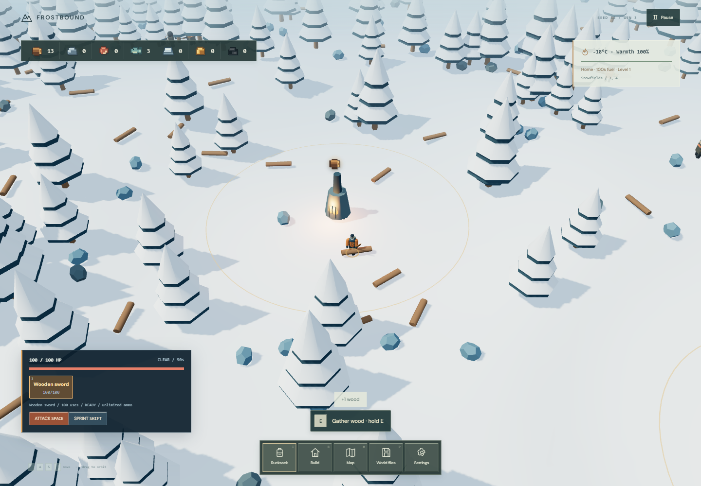

# FYWS: Frostbound

Official repository identity: **`FYWS-Frostbound`**. Open `frostbound.code-workspace` to display that name in VS Code. The existing folder stays in place. No GitHub remote is configured; no remote rename or publication has occurred.

FYWS means **Fuck You Whiteout Survival**. The project began with frustration at misleading mobile-game advertisements. The game is called **Frostbound**, uses original procedural artwork, and has no affiliation with Whiteout Survival or its publisher.

The authoritative brief is [PROJECT_SPEC.md](docs/PROJECT_SPEC.md), copied in full from the supplied `Instructions.md`. See [the implementation plan and feature audit](docs/IMPLEMENTATION_PLAN.md) for phase scope, gaps, and verification. Existing later-phase features remain available while specification compliance is reviewed incrementally.

A local, moddable **Three.js winter survival sandbox**. Explore beyond the furnace clearing, follow rivers, fish, discover ruined settlements, salvage chests, barter with traders, build a camp, and edit your world through portable JSON. There is no backend, login, monetization, or runtime asset download.

## Run

Node.js **20.19+ or 22.12+** is required.

```sh
npm install
npm run dev
```

Open **http://localhost:5173**. On Windows PowerShell with script restrictions, use `npm.cmd` instead of `npm`. Vite prints a LAN address for phone testing on the same network.

```sh
npm run typecheck
npm test
npm run build
npm run preview
```

The built application is in `dist/`; preview serves it at **http://localhost:4173**. Serve it over HTTP rather than opening HTML directly. Dependencies are needed for installation; once built, all gameplay and assets work without contacting external services. This is not an installable service-worker PWA: keep a local server running to load/reload it offline.

## Start exploring

1. Enter a **number from 0 to 4,294,967,295 or a text seed**, randomize it, or enter the current world.
2. **F** starts gathering (wood 0.3s, stone 0.7s, metal 1.1s, gold 2.2s) within three units. Hold it to repeatedly gather timber, stone, or metal. Guaranteed wood and stone sources are beside home.
3. Approach a furnace and press F to burn **one wood for 10 base seconds or one charcoal for 30** (charcoal is selected first). A bold ring and animated flame-like aura show the active warmth area. New worlds start with 60 seconds of fuel and a completed 500-HP worker hut with two workers.
4. Open **Build**. A **hut costs 20 wood**, takes 10 simulation seconds to build, and recruits two workers for wood, stone and fish. Press **T** near a furnace to upgrade; the HUD shows costs and shortages. All new building footprints must fit inside an active furnace range. Storehouses, campfires, City Stores, Workshops and outpost furnaces have distinct functional effects. Preview, rotate, confirm or cancel construction.
5. The map gives a rumour of a generated settlement. Follow it, search the chest, and interact with the trader. Gold purchases and direct resource barter are supported.
6. Follow a riverbank to a **blue fishing post**. Interact and remain still for four seconds to catch fish. Fish can restore warmth or be traded.
7. Use **Save / JSON** to save locally, download full worlds, or create/import fresh sandbox starting configurations.

## Controls

| Action | Desktop | Touch |
| --- | --- | --- |
| Move | WASD / arrows, relative to camera | Left virtual joystick with radial dead zone |
| Sprint | Hold Shift | Hold Sprint |
| Attack | Left click or Space; attacks follow movement facing | Attack; hold to repeat within cooldown |
| Equipment | 1-6 select owned, usable weapons in acquisition order | Tap owned weapon in rack or Rucksack |
| Interact / gather | F; hold for resource gathering | Interact; hold for gathering |
| Orbit camera | Hold right mouse and drag; release does not fire | Drag on right half of terrain |
| Zoom | Mouse wheel | + / − buttons |
| Inventory / storage / food | E (I also works) or Inventory | Inventory |
| Construction | B or Build | Build |
| Rotate preview | R or Rotate | Rotate |
| Confirm placement | F or Confirm placement | Confirm placement |
| Map | M | Map |
| Save / import / export | Shift+S saves immediately; P opens files | Save / JSON |
| Close / cancel / pause | Escape | Close / Cancel / Menu |

The joystick returns smoothly to neutral. Right-side camera gestures begin on terrain, so buttons and the left joystick do not rotate the camera. Blur and pause clear movement, sprint and held attacks. Attacks share the combat system, cooldown, durability and damage rules across mouse, keyboard and touch.

**Planned controls, not yet implemented:** fixed weapon bindings 1=bow, 2=shotgun, 3=Molotov, 4=wooden sword, 5=spear, 6=machete; dedicated F/Pickup; touch ranged Aim; pinch zoom. Current pickup uses the F/Interact prompt. Mouse wheel always zooms. Inventory and map open with E/M (I remains an inventory alias) and close with E/I or M as appropriate, as well as Escape.

Tap/click terrain to reposition a selected building preview. Placement is limited to 15 units from the survivor and rejects deep water, steep slopes, solid overlaps, occupied player space, the home delivery apron, and essential trader/chest/fishing access. Costs spend positive stored resources first, then carried resources. Failed/cancelled purchases do not spend anything.

The default **Relaxed exploration** mode loses warmth slowly and has no cold defeat. **Survival** makes exposure dangerous; a defeat dialog lets you recover at home without deleting your world. Furnaces, shelters, food, and cold exposure all affect actual player warmth. There is no timed expedition victory or single-objective completion in v2. The HUD shows Sunny/Storm icons and a day/night countdown. Weather still cycles in the background, without an objective countdown.

## Resources and camp simulation

The **Rucksack** uses a recessed, Minecraft-inspired material grid, original pixel item artwork, readable quantities, and a survivor preview. Select a material in the carried grid or camp-storage row to inspect it; use **Store supplies**, **Take 1**, or the food buttons for actual transactions. Empty squares are visual space, not an additional slot-capacity rule. The interface displays aggregate material totals, including negative or large sandbox balances. Mobile layouts use six columns. Inventory actions preserve their success/error feedback.

Definitions live in `src/data/definitions.ts`: wood, stone, meat, fish, metal, gold. **Carried inventory and settlement stockpiles are separate.** Store positive carried supplies beside any furnace or storehouse; retrieve resources there through inventory controls. The optional carried limit counts positive units only; a storehouse adds 50 capacity when a limit is enabled. Negative balances are retained, not silently cancelled by storage.

Each resource balance defaults to the inclusive integer range **-2,147,483,648 to 2,147,483,647**. Imports may contain negative values, including the extremes. By default, a cost cannot take its account below zero. Enable **Allow resource debt** to permit that behavior, including trading counterparties. The central transaction system validates every account before committing a cost, transfer, or exchange. Limits and finite integer arithmetic remain enforced with debt enabled.

Hut workers seek reachable wood, stone and fish within 26 units of their hut, use obstacle-aware routes, carry up to three, and physically return to the nearest storage/furnace delivery area. Resources enter the shared stockpile **on delivery**. Depleted, inaccessible, or full-destination scenarios pause production. Healthy workers tend nearby owned furnaces when reserves fall to 20 fuel units, using carried timber or shared stored wood. They gather wood first when fuel is needed. Workers retreat to their own intact, unburning huts at night and stop gathering or fuelling until morning. An occupied hut becoming a ruin ejects hidden workers with half their current HP, once. Simulation continues for constructed camps outside the rendered area and pauses with menus or a hidden tab.

The first furnace upgrade costs **30 wood**; later costs use all materials. Each level adds 0.2 seconds to the fuel consumption interval. Level 1 radius is 12; it expands by 8 only at levels 5, 10 and 20 (20/28/36 units), capped at three expansions. Fuel-efficiency upgrades continue through level 50. Extinguished furnaces provide no heat at any level. Outpost furnaces start empty. Campfires cost 5 wood and restore 6% maximum HP and 6 warmth per second within five units for 15 seconds.

Rivers are carved valleys with visible banks, water, and timber bridges every 64 east/west units. Water is crossable with hypothermia penalties; the visible bridge deck stays dry and its rails prevent sideways falls. Fish availability and deterministic catches are persisted per location. Chest loot, mined nodes, discoveries, NPC stock, buildings, workers, and furnace modifications survive leaving and reloading chunks.

## World generation

The world is **not bounded to the initial clearing or initial region**. Default chunks are 32 × 32 units; the starting-region scale is 256 × 256 units. Additional positive and negative chunks are generated as you explore. Initial region size is metadata for the starting scale, not a hard boundary or a request to build the entire world up front.

The renderer loads a square of nearby chunks (distance 1–3, default 2), creates at most two chunk render groups per frame, and disposes distant geometries, instancing buffers and nonshared materials. Repeated trees and resource props are instanced. Static generation caches at most 129 chunks; persistent modifications live separately in save state. Terrain uses world-coordinate samples at shared edges, so generation order cannot change it. WebGL 2 is required and initialization failures produce a readable error.

Generation version **6** uses Mulberry32 plus independent coordinate-addressed streams. Stream seeds support unsigned 32-bit values derived with FNV-1a and a documented integer avalanche (numeric seeds 0-65535 retain their original 16-bit streams for layout compatibility) in `src/utils/SeededRNG.ts`. The eight stream labels are terrain, rivers, biomes, resources, ruins, villages, wildlife, and loot. Ordinary resource coordinates/amounts use only their resource stream; cliff deposits follow terrain-generated cliff sites with quantities from the resource stream; changing that stream does not move terrain, rivers, or trees. Terrain/rivers intentionally cooperate to carve waterways. Wildlife seeds encounters and weather; villages seeds guard composition; loot seeds equipment-drop outcomes. The current three village positions are fixed rather than randomly placed.

Generations 3 and 4 require all eight seeds. Generations 1 and 2 remain supported: when their village/loot fields are absent, import uses their stored wildlife seed for those fields, retaining the previous outcomes. Terrain and resource geometry are preserved. Exported JSON includes every stream seed and the generation configuration. Edit `world.seeds.resources` to customize resources independently. `world.config` supports chunk size, starting-region scale, terrain scale, river density, ruin density, and resource density. With densities set to zero, the corresponding optional features can be absent; default settings provide rivers and a starting-region ruin. Resource candidates that lie in deep water are not rendered or harvestable; other accessible nodes and guaranteed starter sources remain available.

## Saves and sandbox JSON

**Local save:** one v2 slot under `frostbound.world.v2`, saved manually or every 20 seconds of active simulation. No old world is automatically loaded over the main menu; use **Load Save**. Storage failures are reported; export JSON as an alternative. v1's `frostbound-save` key is left untouched.

**Full save** restores the exact mutable world. **Sandbox configuration** always creates a clean player at home and applies starting balances, home furnace parameters, settings and generation rules. It does **not** carry over old buildings, positions, NPC trades, discoveries, node depletion, or fishing catches. These are deliberately different import modes.

See [docs/SAVE_FORMAT.md](docs/SAVE_FORMAT.md), [examples/sandbox-config.json](examples/sandbox-config.json), and [examples/full-world.json](examples/full-world.json). In Save / JSON, **Fill with current sandbox config** gives an editable starting document. Import requires **Validate import**, then a separate **Confirm: replace active world** action. Validation and cancellation never mutate the active world. Editing text or changing modes invalidates a pending import. Downloads are valid JSON, not browser-specific binary data.

Format version **1** and generation version **1** are supported. Unknown versions are rejected clearly, rather than silently regenerating a different world. No v1 Phaser-save migration is claimed. Future generation changes must introduce a new generation version and an explicit compatibility/migration path. Imported coordinates are limited to ±1,000,000 units to retain useful numeric precision. Larger imported inventories are permitted within resource bounds; if an enabled carrying limit is already exceeded, additions remain blocked until space is freed.

## Architecture and v1 preservation

```text
src/
  main.ts                       Initialization and graceful WebGL error screen
  game/Game.ts                  Simulation coordinator and interaction actions
  game/GameState.ts             Serializable, renderer-independent state
  game/GameConfig.ts            Seeds, generation version, settings
  game/audio.ts                 Original synthesized v1 audio, retained
  world/WorldManager.ts         Coordinate terrain/rivers/biomes/ruins/nodes, bounded cache
  systems/InventorySystem.ts    Atomic, bounded transactions and barter
  systems/SurvivalSystem.ts     Fuel, heat, environmental cold, warmth
  systems/Navigation.ts         Worker and test navigation
  systems/SaveSystem.ts         Versioned validation, detached import, exports, local saves
  rendering/Renderer.ts         Three.js camera, lighting, meshes, chunks, cleanup
  ui/App.ts                     Input, touch controls, loop, modal lifecycle, previews
  ui/Panels.ts                  Inventory, trades, building, settings, map and JSON UI
  data/definitions.ts           Resource and building definitions
  data/trades.ts                Trader specializations and offer definitions
  utils/SeededRNG.ts            Deterministic RNG, hash derivation and smooth noise
  styles/main.css               Desktop, mobile and landscape interfaces
```

The inspected v1 source, tests, README and configuration are preserved in **`archive/frostbound-v1.zip`**. The active project runs **only Three.js**; Phaser was removed. The original Vite/TypeScript setup, local fonts, synthesized audio, interaction loop, 5-wood huts and 30-wood expansion concepts were retained where compatible. The small timed arena, sprite renderer and round-local model were replaced because they could not represent the required 3D persistent sandbox.

## Verification and milestone status

```sh
npm test
npm run typecheck
npm run build
# With the dev server running in another terminal:
npx playwright install chromium
npm run test:browser
# Inventory / field-kit UI checks (dev server running):
npm run test:ui
npm run test:combat
npm run test:foundation
# With npm run preview serving the production build:
npm run test:production
```

The browser suite uses installed Microsoft Edge on Windows if available, otherwise Playwright Chromium. Set `BROWSER_EXECUTABLE` to choose a Chromium executable. Outputs/screenshots are in ignored `test-results/`.

The earlier prototype implemented: navigable 3D terrain, keyboard/touch movement, unsigned 16-bit seeds, reproducible terrain and separate resources, gathering, inventory, real heat survival, rivers/fishing, explorable ruins, NPC barter, saved construction, full JSON restore, clean sandbox imports, negative resources, failure-safe imports, and build/gameplay verification.

The Phase 1 audit started from 20 passing simulation/data tests and a passing build. Final verification passed 27 tests, typecheck/build, and all five browser suites (gameplay, inventory UI, combat, foundation, production). New foundation tests cover stream isolation, legacy geometry fingerprints, input transforms, analog dead zones, and movement reset. Browser suites exercise real controls and gameplay; the phase report records the commands actually run. Automated Chromium/Edge checks do not replace physical iOS/Android testing or long-duration endurance testing.

Deliberate first-milestone limits: simple procedural low-poly art, repeating but seed-varied ruin layouts, fixed trade offers, seven resources, finite fish/loot reserves, one gathering worker role, shared camp storage, no entering building interiors, and no advanced processing chains or dynamic market pricing. Those are extension work, not placeholder buttons in the current interface.

All mesh artwork and synthesized sounds are original procedural work. Bundled Oxanium and Rajdhani use the SIL Open Font License; notices ship in `public/licenses/` and the production build.

## Combat and whiteouts

Start a new expedition for terrain generation 6 and its three distant fixed villages: Hearthwatch (128, 8), Stonehaven (-144, -32), and Northpass (192, 176). Each has packed paths connecting houses, trading areas and the entrance. Older saves preserve their village sites. Villages have traders, 3-5 armed guards, and a furnace. Old terrain-generation-1 saves keep their original terrain and ruins. Bandits roam in groups of 2-10; polar bears and arsonists also patrol. Guards fight enemies and retaliate when you attack their village.

Move with the keyboard or joystick to set facing; that direction is retained when you stop. Left click and the touch Attack button assist a nearby reachable hostile; otherwise attacks follow your facing. Space attacks forward. Mouse movement does not redirect the survivor. Equip from the weapon rack, keys 1-6, or the Rucksack equipment list. Hold Shift to sprint (9 rather than 6 units/sec), or hold the touch Sprint button; exposure consumes twice the warmth. New survivors start unarmed with a 2-damage punch; weapons can be traded, purchased for gold at City Stores, or found in village supplies. Traders sell all six weapons using carried resources, and defeated bandits have a deterministic 25% weapon-drop chance, with 40-80% durability already used. Other armed actors retain a 7% chance. Dropped Molotovs contain 1-5 uses; village Molotov pickups still contain one. Collect drops with F. Melee weapons wear once per successful enemy-hitting swing, with durability set per weapon. Ranged weapons have limited uses and unlimited ammo; enemy weapons never wear out.

| Weapon | Damage | Cooldown | Effect |
| --- | --- | --- | --- |
| Wooden sword | 8 | 1s | 25 successful hits |
| Stone sword | 12 / 10% chance of 1s stun | 1s | 50 successful hits |
| Spear | Random 3-10 | 1.5s | Longer melee reach |
| Machete | 25 + 7 bleed/second for 7s | 1.5s | 100 successful hits |
| Bow | 10 + 3 bleed/second for 5s | 2s | 100 shots |
| Shotgun | 15 / 50 / 105, wide / close / closest | 4s | 21 shots |
| Molotov | 3/sec | 4s | Traveling bottle, 4-unit radius, 10s fire; friendly fire applies |

One world unit is one tile. Weapon values follow the current balance update; the complete durability and gold-shop table is in [Night and balance](docs/NIGHT_AND_BALANCE.md). All values live in `src/data/weapons.ts` and `src/systems/CombatSystem.ts`. Player, traders, and workers have 100 HP; bears/wolves 50, bandits/guards 125, arsonists 75. Combat defeat opens the recovery dialog.

Fire converts timber nodes and standing trees into gatherable charcoal after ten seconds. Charcoal adds 30 base fuel seconds; wood adds 10. Both use the level-adjusted burn interval, and F consumes charcoal first. A whiteout starts after 90 seconds, lasts 55 seconds, triples fuel consumption, reduces visibility, and increases enemy detection distance. Clear intervals thereafter last 90-150 seconds. Furnace reinforcement and chimney models change at every fifth furnace level through level 50; heat radius expands only at levels 5, 10 and 20, for three expansions maximum. See the [complete upgrade cost table](docs/FURNACE_UPGRADES.md).

Save format 2 includes HP, actors, equipment durability, projectiles, fire, bleed, drops, weather, village hostility, and burned terrain. Format 1 files migrate with full health, a starter sword, and zero charcoal. Full saves retain combat state; sandbox imports reset encounters but retain the configured starting equipment. JSON imports validate all combat fields before replacing the active world.

Run `node tests/combat.mjs` for desktop/mobile combat UI smoke checks (requires the dev server). `npm test` includes combat simulation and persistence regressions.

## Actual game capture



Captured from the running generation-3 game by `preview:survivor`, showing the new original rigged character at close range. The full verification record and remaining requirements are in [the phase plan](docs/IMPLEMENTATION_PLAN.md).

## Survivor and collection presentation

The player now uses the original local Wayfarer GLB: a skinned winter survivor with clothing, face covering, backpack, animated locomotion, gathering, six weapon actions, damage and death. Held weapons attach to hand bones; bow/shotgun poses use a support-hand solver. The original contour model and animation source are included, with a local fallback if the GLB fails to load. See [asset provenance and presentation notes](docs/PRESENTATION.md) for art scope and licensing.

Successful gathering, fishing and chest salvage emit cosmetic icons that rise from the collection point, curve to the actual HUD resource cell, and pop the number on arrival. Inventory is awarded once at collection time. Effects are capped, cleaned up and disabled for reduced motion. Chunk refreshes keep old terrain visible until replacements are ready, correcting revision-related scene flicker.

Run `npm.cmd run test:presentation` with the dev server running. Rebuild the original GLB with `npm.cmd run asset:survivor`. No new package or downloaded model is required.



## Settlement presentation and furnace defense

Fuel, furnace upgrades and completed buildings now use the resource-flight presentation system. Supply icons fly toward the world target, followed by a receipt toward the HUD; real costs are applied once before animation. Reduced motion and effect caps remain supported.

Traders, workers and hostile humanoids now use the original rigged character library. Fourteen human appearances and two original rigged bear models are prepared locally; two original wolf variants join the library, with shared templates and independent skeletons. Trading has separate Resources/Weapons tabs, clear pay/receive cards, precise shortages and disabled unaffordable purchases.

Inside an active player-owned furnace heat zone, incoming player damage is reduced by **50%**. Hostile enemies lose **10% of max HP on entry**, once until they leave and re-enter; overlapping circles do not stack. Village furnaces and extinguished furnaces do not grant this combat protection. Enemy collision steering and speed-driven animation replace the previous shove-and-slide movement. Furnace model tiers now change at levels **5, 10, 15, 20 and 25**.

See [settlement rules, model provenance and verification](docs/SETTLEMENT.md). Run `npm.cmd run test:settlement` with the dev server running.

## Controls, melee, weather and recovery update

Furnace interaction immediately binds recovery to that furnace, including village furnaces and interactions without available fuel. E opens inventory, B construction, M map, and Shift+S saves. The death screen offers Go Back (lose half of positive carried and stored resource stacks), Return to Home (save to the title menu), and New World (replace the local save). Equipment/buildings are retained by recovery; debts remain and odd stacks round down. See [recovery details](docs/RECOVERY.md).

## Assisted attacks and visible hits

Left click assists the nearest reachable hostile within weapon reach (ranged assist capped at 12 units); peaceful guards are excluded from assist. Blade collision follows the same sweep used by the model pose, arrows include their full shaft/head extent, shotgun pellets collide during flight with one damage application per target per volley, and low-flying Molotov contact causes impact damage and fire. Actual HP loss appears as bounded world-projected damage numbers, including bleed and protection reductions. See [combat hit details](docs/HITS.md).

## Furnace recovery and settlement expansion

Active furnace ranges heal 25 HP every three uninterrupted seconds, reduced to 10 when recently attacked inside heat; three damage-free seconds restore 25. Owned heat zones also double damage taken by hostiles and halve their movement, alongside entry damage, 12 HP/second burning, and player protection. New worlds and respawns grant a 100-metre safe area for 12 simulation seconds, anchored at the spawn point. Hostiles are kept outside and a HUD countdown shows protection while inside. The existing five-second respawn immunity is retained. New expeditions reset every upgrade and start unarmed.

Harvesting takes 0.3s for wood, 0.7s for stone, 1.1s for metal and 2.2s for gold; standing trees shake/fall into finite logs, and large boulders split into smaller stones. Traders and guards shelter when hurt. Workers shelter below 50 HP and recover inside their hut. Built huts have 1,000 HP, the free starting hut has 500 HP, and storehouses 2,000; destroyed structures become quarter-health ruins, then finite salvage. Buildings are bleed-immune. Village supply piles roll 50% food, 40% materials and 10% random weapons. See [expansion rules and verification](docs/EXPANSION.md).

Wilderness update: wolves hunt in packs of 3-12, bears deal 15/30 damage and stun, and wading causes persistent hypothermia. E toggles inventory; M closes inventory or toggles the map. Larger block typography and status cards show current effects. See [wilderness rules and validation](docs/WILDERNESS.md).

The latest [camp progression update](docs/CAMP_PROGRESSION.md) adds the T upgrade HUD, fifty furnace levels, construction, mixed-resource workers, stronger hills, hypothermic lakes and a forest/elevation map. Generation 1-4 saves retain their original terrain.

The [spawn and visibility update](docs/SPAWN_VISIBILITY.md) documents the starting camp, spawn protection, terrain-following warmth aura, bridge rails and stronger whiteout fog. Existing full saves preserve their saved fuel, buildings and protection countdown.

The [hunger, City Store and night update](docs/NIGHT_AND_BALANCE.md) adds movement-based hunger, revised weapons, finite healing campfires, shared-storage salvage, worker HP inspection and world-distance visibility. Day and night alternate every ten simulation minutes; storm fog stays thick at every zoom level.

Worker tending and pause update: wolves leave deterministic 0-2 meat pickups; meat restores 3 hunger, fish 2 (both +5 HP, shared 3s cooldown). The pause screen places resume/save/exit first and keeps the desktop/touch control guide collapsed until opened. [Rules and verification](docs/WORKER_FUEL_AND_PAUSE.md).

Text seeds are trimmed, Unicode NFC-normalized, case-sensitive and hashed deterministically to an unsigned 32-bit seed. The original text is preserved in saves. The [seed and HUD update](docs/SEEDS_AND_WEATHER.md) documents numeric bounds, legacy compatibility and the open-ended survival HUD.

Workers can fell standing trees and break large boulders before gathering their logs/fragments. They use visible axes/pickaxes, approach outside solid colliders within tool reach, and temporarily skip unreachable sources rather than becoming stuck on one. Harvested resources remain finite and reach shared storage on delivery. [Worker harvesting details](docs/WORKER_HARVEST.md).

Building and furnace HP can be inspected with mouse hover or a brief touch label, including quarter-health ruins. The interface uses locally bundled Oxanium headings, Rajdhani text, etched steel panels and brass accents. See [night shelter and inspection](docs/NIGHT_SHELTER_AND_INSPECTION.md).


## Ore cliffs, renewable forest and world preparation

New generation-6 worlds contain 28-46-unit cliffs that block movement and sight. Gold, stone and metal can be mined from finite deposits around their accessible bases; ore cliffs are marked on the map. Existing generation 1-5 worlds keep their terrain and sites.

Chopped or burned trees leave a stump and regrow after 20 simulation minutes. Hover or tap the stump to see remaining growth time. Timers survive saves and chunk unloading, and stop while paused. Regrowth replaces the old ground timber/charcoal cycle; supplies already collected remain yours. Occupied building footprints defer regrowth until space is available.

World entry shows real preparation progress while survival is paused. The visible area plus an outer ring is generated, nearby character assets are readied, and shaders are warmed before play. Exploration builds one chunk mesh per frame and prefetches the next ring; harvesting invalidates only affected chunks. Bounded lake/cliff region caches reduce repeated terrain queries. This reduces avoidable work but does not guarantee a fixed FPS on every device.

Bandits also roll an independent 25% chance for 0-4 gold; weapon-drop rules are unchanged. Zero is a valid roll. Gold is collected from the resulting supply pile with the existing collection feedback. See [implementation and verification](docs/CLIFFS_REGROWTH_LOADING.md). Run `npm run test:cliffs` for the focused browser checks.


## Workshops, construction and shelter

Build a **Workshop** for **25 wood + 10 stone + 3 metal**, taking **10 seconds**. Its entire footprint must be covered by an active, completed furnace at **level 5 or higher**, including village furnaces. The blacksmith model includes a forge, chimney, workbench and anvil. Approach and press **F** to craft/equip weapons using their existing material prices, spending stored supplies before carried supplies. Workshop HP defaults to 1500. Burning, ruined and unfinished Workshops are unavailable.

Every new building must fit wholly inside an active furnace range, wherever it is placed. Existing buildings are preserved. Construction takes: worker hut **10s**, storehouse **5s**, campfire **3s**, City Store **10s**, outpost furnace **30s**, Workshop **10s**. Unfinished buildings provide no service, heat, fuel acceptance, campfire healing or storage bonus. Destroying a worksite cancels construction without granting workers or completed effects.

Press **F** beside an unoccupied, completed hut to hide; press **F** again (or use Interact on touch) to leave. It heals **3% of current maximum HP per second**, blocks hostile damage and hides the survivor from enemies. Enemies can attack the hut, and ruin or fire ejects the player. Furnace healing does not stack while sheltered. Hunger and environmental exposure remain active. Workers whose hut becomes a ruin stop working and travel toward the nearest village, retaining carried supplies; they remain displaced villagers rather than producing supplies at the lost hut.

Player chopping/mining now shows an axe/pickaxe and faces the resource during the deliberate action. Movement continues to set ordinary facing. Furnaces have stronger fire visuals and bounded floating embers, with reduced-motion support. Resource counters sit beside the title, and blizzard maps use pale mist instead of opaque darkness. HP is red below 15%, green otherwise and blue at full health; hunger is red below 15%, amber below 50%, and green from 50-100%. Critical HP adds a slow, reduced-motion-aware edge warning.

See [Workshop and shelter verification](docs/WORKSHOP_AND_SHELTER.md). Run `npm run test:workshop` for the focused browser suite.
